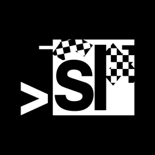

# KXLaunch

 **KXLaunch** — кастомное, быстрое и энергоэффективное Home Menu для **Nintendo Switch** (форк sLaunch).

[](https://t.me/kvinkxerli)


---

## 🌟 Особенности форка KXLaunch

* **Нативный выбор профиля Switch:** при нажатии на игру открывается стандартное системное окно выбора профиля Switch («Кто будет играть?»), если на консоли зарегистрировано несколько аккаунтов.
* **Исправлена инициализация сохранений:** устранена проблема падения игр на движках Unreal Engine / Unity (например, *A Hat in Time* и др.), корректно генерируются атрибуты и метаданные сохранений (`owner_id`, `Thumbnail` только для профилей).
* **Полноценные звуковые эффекты меню:** восстановлены звуки пролистывания игр (`Move`), переключения страниц (`PageLeft`/`PageRight`), выбора и кликов (`Confirm`/`Click`/`Back`) со встроенными fallback-звуками.
* **Режим Line по умолчанию:** минималистичный и чистый интерфейс с плавным скроллингом и низким энергопотреблением.
* **Полная русская локализация:** интерфейс и системные подсказки переведены на русский язык (с поддержкой английского и других языков).

---

## 🎮 Основные возможности

* **Темы и персонализация:** встроенные темы, поддержка пользовательских обоев, наборов иконок (включая Minimal), кастомных шрифтов (TTF/OTF/TTC) и различных режимов отображения (Line, Grid, Flow, Deck, Shelf, Cover, List, XMB).
* **Видео-обои:** поддержка бесшовных зацикленных видео-фонов `.mp4` с аппаратным декодированием NVDEC.
* **Интерактивные виджеты:** виджеты на базе Lua (часы, календарь, погода, крипта и др.) с поддержкой сенсорного управления.
* **Фоновая музыка и звуки:** воспроизведение музыки в меню (MP3/OGG/FLAC) с возможностью продолжения трека, а также кастомные звуки интерфейса.
* **Раздельные профили:** индивидуальные настройки тем, раскладок и избранного для каждого аккаунта на консоли.
* **Передача файлов по USB (MTP):** прямое подключение к ПК по USB в меню для копирования файлов на SD-карту без перезагрузки и извлечения карты.

---

## 📥 Установка

1. Скачайте свежий архив **`kxlaunch.zip`** из релизов.
2. Распакуйте содержимое архива в корень вашей SD-карты (`sdmc:/`), согласившись на замену файлов.
3. Перезагрузите консоль с кастомной прошивкой (Atmosphère).

---

## 🛠️ Сборка из исходников

### Требования
* Установленный **devkitPro** (`devkitA64`, `libnx`, `AtmosphereLibs`).
* Пакеты: `switch-dev`, `switch-sdl2`, `switch-sdl2_ttf`, `switch-sdl2_image`, `switch-sdl2_mixer`, `switch-curl`, `switch-mbedtls`.

### Команды сборки
```bash
# Сборка всех компонентов и подготовка структуры SdOut/
make

# Упаковка готового релиза в kxlaunch.zip
make package

# Очистка сборки
make clean
```

---

## 💬 Контакты и обратная связь

* **Telegram разработчика форка:** [@kvinkxerli](https://t.me/kvinkxerli)

---

## 🙏 Благодарности и Credits

* **sLaunch (etonedemid):** оригинальный проект меню для Switch.
* **uLaunch (Xortroll & contributors):** архитектура системного демона/апплета, ECS и NPDM (GPLv2).
* **nx-hbloader (switchbrew):** загрузчик Homebrew (ISC).
* **Atmosphere (haze):** протокол передачи файлов по USB MTP (GPLv2).
* **MeepCat55:** создатель набора иконок `Minimal`.
* **Xelu:** иконки кнопок геймпада (CC0).
* **averne / FFmpeg (nvtegra) & SwitchWave:** аппаратное ускорение видео NVDEC (GPLv2+).
